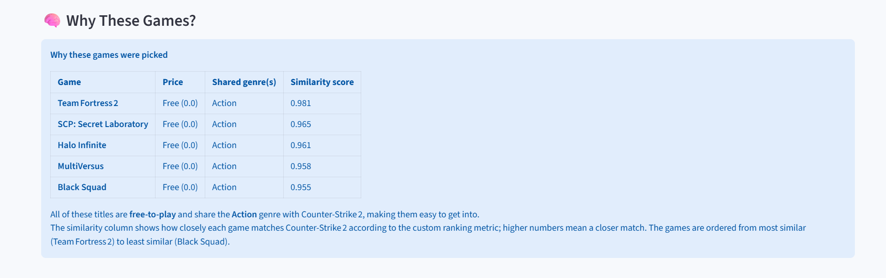
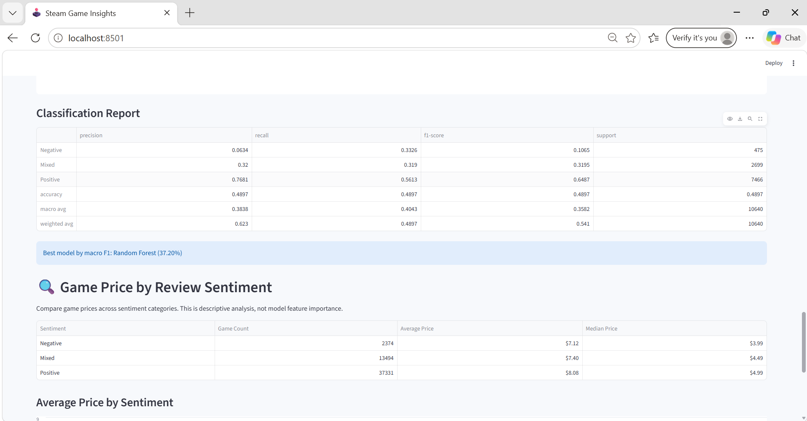
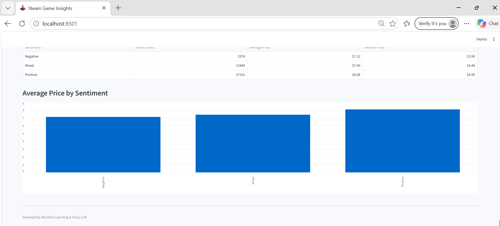
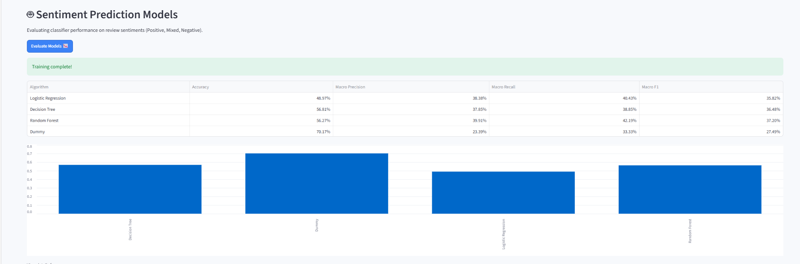

# AI-Powered Steam Game Analytics and Recommendation System

## Project Overview

The AI-Powered Steam Game Analytics and Recommendation System is a machine learning-based application designed to analyze Steam games and recommend similar games to users.

The system combines exploratory data analysis, sentiment classification, content-based recommendation, and AI-generated explanations through an interactive Streamlit dashboard.

## Objectives

- Analyze Steam game data to identify useful patterns and trends.
- Explore game prices, genres, and user reviews.
- Classify games into Positive, Mixed, and Negative sentiment categories.
- Recommend similar games using content-based filtering.
- Generate natural-language explanations for recommendations.

## Technologies Used

- Python
- Pandas and NumPy
- Scikit-learn
- Matplotlib
- Streamlit
- Groq API
- Jupyter Notebook

## Machine Learning Models

- Logistic Regression
- Decision Tree Classifier
- Random Forest Classifier

## Recommendation System

The project uses content-based filtering based on game genres, price similarity, and popularity.

## Dataset

**Dataset:** Steam Games Dataset 2025

**File:** `games_march2025_cleaned.csv`
https://www.kaggle.com/datasets/artermiloff/steam-games-dataset/data

The dataset is available from Kaggle. It is not included in this repository because of its large file size.

Download the dataset from its original Kaggle source and place it in the project directory before running the application.

## Project Structure

```text
Steam-Game-Analytics/
├── ML.ipynb
├── ML_Project.ipynb
├── app.py
├── model_evaluation.py
├── recommendation.py
├── requirements.txt
├── .gitignore
└── README.md
```

## Installation and Execution

1. Clone the repository:

```bash
git clone https://github.com/nmeghana92/Steam-Game-Analytics.git
```

2. Navigate to the project directory:

```bash
cd Steam-Game-Analytics
```

3. Install dependencies:

```bash
pip install -r requirements.txt
```

4. Download the dataset and place it in the project directory.

5. Configure the Groq API key in a local `.env` file if required.

6. Run the Streamlit application:

```bash
streamlit run app.py
```
## Application Screenshots

### 1. Main Recommendation Interface


### 2. Recommended Games


### 3. AI-Generated Explanation


### 4. Exploratory Data Analysis


### 5. EDA Visualizations


### 6. Confusion Matrix


### 7. Game Price Analysis


### 8. Additional Price Analysis


### 9. Dummy Classifier Evaluation


## Project Status

The project includes data preprocessing, exploratory data analysis, machine learning classification, content-based recommendations, and a Streamlit dashboard.

## Author

Meghana Nimmaluri
